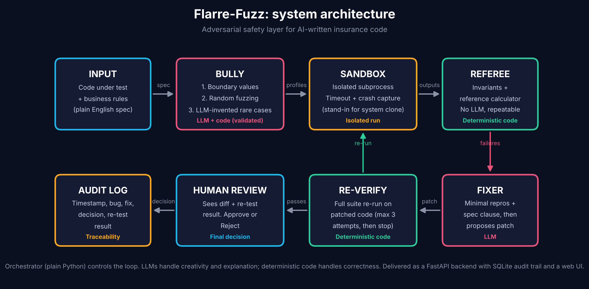

# Flarre-Fuzz 🥊

**An AI boxing ring that attacks AI-written insurance code before it reaches a carrier's systems.**

AI agents now write pricing and rating logic for insurers, and one small mistake (a wrong boundary, a missing cap,
a rounding slip) can misprice thousands of policies. Flarre-Fuzz is an adversarial safety layer: a **Bully** invents
the nastiest customers, a **deterministic Referee** judges every answer, a **Fixer** proposes a repair, the **full suite
re-runs** on it, and a **human** approves. Every step is logged.

> **Design rule:** LLMs handle creativity and explanation. Deterministic code decides what is correct.



## Quick start
```bash
./run.sh            # macOS / Linux   (Windows: double-click run.bat)
```
or manually:
```bash
pip install -r requirements.txt
python -m flarre_fuzz          # opens http://127.0.0.1:8000, then click "Run scan"
pytest                         # 22 tests (never calls a real LLM)
python -m flarre_fuzz.ablation # which Bully layer finds which bug
```
Optional LLM layers: `export ANTHROPIC_API_KEY=...` (model override: `FLARRE_MODEL`). Without a key the Fixer uses a
stored patch and the UI says so.

## Using your API key (enables the LLM layers)
```bash
cp .env.example .env          # then put your key in .env  (it is git-ignored; never commit or share it)
python -m flarre_fuzz.check_llm   # verifies the key, runs the LLM Bully + Fixer, prints a MEASURED ablation table
python -m flarre_fuzz             # the Arena now shows "LLM: <model>"; tick the "LLM-invented" layer and Run scan
```
Get a key at console.anthropic.com (API access is billed separately from a Claude chat subscription; a full scan costs a few cents).
If anything is wrong (bad key, no credits, wrong model name) the UI and `check_llm` say exactly what, instead of failing silently.

## What's in the box
| | |
|---|---|
| `flarre_fuzz/` | The working system: Bully, sandbox, Referee, minimizer, clause retrieval, Fixer, orchestrator, FastAPI, SQLite, Arena web UI |
| `tests/` | 22 pytest tests (core logic and the full API flow) |
| `docs/FlarreFuzz_Proposal.pdf` | 3-page proposal |
| `docs/FlarreFuzz_Presentation.pptx` | 7-slide deck |
| `docs/presentation_interactive.html` | **Interactive 9-slide presentation with a live in-browser demo** (just open it) |
| `docs/architecture_interactive.html` | **Clickable architecture diagram with a "play a scan" animation** (just open it) |
| `docs/DEMO_SCRIPT.md` | A 4-minute demo script with a fallback plan |
| `docs/QA_PREP.md` | The tough questions you will get, with honest answers |
| `docs/SUBMISSION_CHECKLIST.md`, `docs/EMAIL_TEMPLATE.txt` | Ready for the email to the organisers |
| `personalize.py` | Puts your name and college into every deliverable |

## What the Arena UI shows
Animated Bully-vs-Referee scan · (age × claims) coverage heatmap · root-cause bars · **minimal reproductions**
("age 25, no claims, expected 500, got 750, violates spec rule 2") · patch diff · approve/reject with reason ·
ablation tab · audit timeline.

## Results (measured; toy calculator with 5 planted bugs; deterministic layers only)
| Planted bug | Boundary only | Random only | Boundary + random |
|---|---|---|---|
| age boundary (`<=` vs `<`) | found (24) | found (11) | found (33) |
| claims surcharge cap | found (137) | found (777) | found (904) |
| 20% discount cap | found (108) | found (263) | found (362) |
| truncation vs rounding | found (89) | found (313) | found (392) |
| age-29 off-by-one | **MISSED** | found (8) | found (8) |
| false alarms on correct code | 0 | 0 | 0 |

The hand-picked boundary layer never probes age 29, so it misses that bug. That is exactly why several layers exist.

## Engineering map
| Skill | Where |
|---|---|
| Python, Git, best practice | Packaged code, type hints, 22 tests, commit history |
| Data structures & algorithms | Hash-map neighbour checks (monotonic invariant), delta-debugging failure shrinker, set-based dedupe |
| REST & backend | FastAPI: `/scans`, `/scans/{id}/decision`, `/audit`, `/ablation`, `/health` |
| JSON, databases | SQLite persistence; Pydantic validation of every LLM output; `ast` check on patches |
| LLMs / GenAI | Bully invents rare cases; Fixer proposes patches (both optional, both validated) |
| Retrieval | TF-IDF clause retrieval links each failure to the spec rule it violates |
| Agent frameworks | Orchestrator is plain Python by choice; maps directly onto a LangGraph state graph |

## Honest status
- The LLM Bully and Fixer are built and validated but **not yet measured** (needs an API key). They add columns to the ablation once configured.
- The target is a **toy calculator** written for this project; the sandbox is **process isolation**, not a replica of a carrier system (never expose it publicly).
- The Referee is only as good as its invariants and reference. Testing finds bugs; it cannot prove their absence.
- The interactive deck's live demo is a **JavaScript port** of the engine (simplified Referee); its Fixer step uses the stored correct patch.
- Flarre already lists a Testing Agent; this is designed as a **complementary adversarial layer**, and its internals were not available for this design.
- The UI was verified with scripted DOM tests and API tests; give it a visual once-over in your own browser.

## Layout
```
flarre_fuzz/   bully · sandbox · referee · reference · minimize · clauses · fixer · orchestrator · schemas · db · api · ablation · static/index.html · data/
tests/         test_core.py · test_api.py
docs/          proposal · decks · diagrams · demo script · Q&A prep · checklist · email template · source/
```
