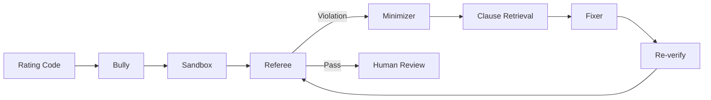

# 🥊 Flarre-Fuzz
### Adversarial Testing for AI-Generated Insurance Code

**AI writes the code. Flarre-Fuzz challenges it.**

A misplaced boundary. An incorrect surcharge cap. A rounding error.

In insurance, small coding mistakes can create costly premium miscalculations.

**Flarre-Fuzz is a multi-agent verification framework that attacks insurance rating logic with adversarial inputs, detects business-rule violations, minimizes failures, and proposes fixes with re-verification.**

### ⚙️ The Agentic Arena

| Agent | Responsibility |
|---|---|
| 🥊 Bully | Generates adversarial test profiles |
| 🏟️ Sandbox | Executes candidate code |
| ⚖️ Referee | Validates deterministic business rules |
| 🔍 Minimizer | Isolates minimal failing inputs |
| 📚 Clause Retrieval | Retrieves relevant rule context |
| 🛠️ Fixer | Proposes targeted repairs |
| 🎯 Orchestrator | Coordinates the entire lifecycle |

### 🔄 How It Works



### 📊 Prototype Benchmark

**Five planted defects. All five detected by the combined strategy.**

| Strategy | Detection |
|---|---:|
| Boundary | 4/5 |
| Random | 5/5 |
| Boundary + Random + Gemini | **5/5** |

40 Gemini-generated profiles · 0 false alarms on the tested correct-code benchmark.

*Controlled prototype results, not production guarantees.*

### 🧠 Engineering Stack

`Python` · `FastAPI` · `Google Gemini` · `SQLite` · `JavaScript` · `Pytest`


### 🚀 Run Locally

```bash
git clone https://github.com/vuppunuthulanandini/Flarre-Fuzz.git
cd Flarre-Fuzz
pip install -r requirements.txt
```

Configure `GEMINI_API_KEY` in `.env` using `.env.example`, then:

```bash
uvicorn flarre_fuzz.api:app --reload
```

Open `http://127.0.0.1:8000`

### 🛡️ Our Design Philosophy

**AI explores. Deterministic rules judge. Humans approve.**

Flarre-Fuzz aims to complement insurance-native AI platforms with an adversarial verification layer — challenging generated logic before it can be trusted.

---

**🥊 Don't just test the happy path. Fight for the edge cases.**

[GitHub Repository](https://github.com/vuppunuthulanandini/Flarre-Fuzz)
