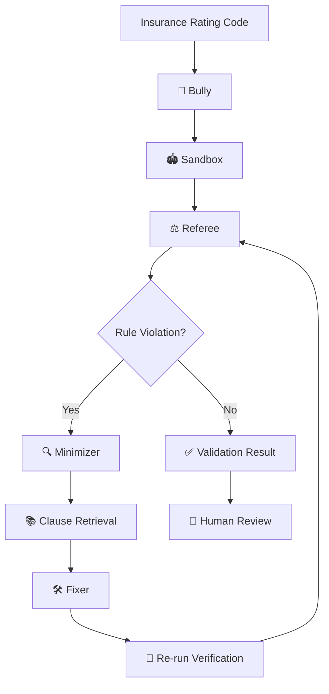

# 🥊 Flarre-Fuzz
### The adversarial testing arena for AI-generated insurance code.

**What if AI writes an insurance pricing function that looks correct, passes basic tests, but quietly misprices thousands of policies?**

Flarre-Fuzz is a multi-agent adversarial testing framework that challenges insurance rating logic with edge cases, discovers hidden business-rule violations, and proposes targeted fixes — then tests the repaired code again.

**AI explores. Deterministic rules judge. Humans approve.**

[🚀 Quick Start](#-quick-start) · [⚙️ How It Works](#-how-it-works) · [📊 Benchmark](#-prototype-benchmark) · [🧪 Example](#-see-it-in-action)

---

## 💡 Why Flarre-Fuzz?

AI-generated code can look convincing while containing subtle mistakes:

- An age boundary handled incorrectly.
- A surcharge that exceeds its permitted cap.
- A discount applied beyond the allowed limit.
- A rounding or truncation error.
- A business rule that fails only for unusual customer profiles.

Traditional tests catch the cases developers think to test.

**Flarre-Fuzz actively searches for the cases they might have missed.**

## 🥊 Meet the agents

| Agent | Its job |
|---|---|
| 🥊 **Bully** | Generates adversarial customer profiles and edge cases. |
| 🏟️ **Sandbox** | Executes the candidate rating code against generated inputs. |
| ⚖️ **Referee** | Checks outputs against deterministic business rules. |
| 🔍 **Minimizer** | Reduces failures to small, understandable counterexamples. |
| 📚 **Clause Retrieval** | Retrieves relevant insurance-rule context. |
| 🛠️ **Fixer** | Proposes targeted code corrections. |
| 🎯 **Orchestrator** | Coordinates the complete testing and repair loop. |

## ⚙️ How It Works



**The important part:** Gemini helps generate challenging inputs and propose fixes. It does not decide whether the insurance logic is correct. The Referee uses deterministic checks against the encoded rules.

## 🧪 See It in Action

Imagine an insurance company has this rule:

> Drivers aged 25 or above should not receive the young-driver surcharge.

But an AI-generated function accidentally uses the wrong boundary.

```python
def calculate_premium(age, base_premium):
    if age <= 25:
        return base_premium * 1.10

    return base_premium
```

A normal test might check age 20 and age 30 — and miss the mistake.

Flarre-Fuzz challenges the boundary:

| Age | Expected behaviour | Actual behaviour |
|---:|---|---|
| 20 | 10% surcharge | 10% surcharge |
| 24 | 10% surcharge | 10% surcharge |
| **25** | **No surcharge** | **10% surcharge ❌** |
| 26 | No surcharge | No surcharge |

The Referee identifies the violation, the Minimizer isolates the failing input, and the Fixer proposes a correction.

The repaired code is then tested again.

**Find it → Explain it → Fix it → Verify it.**

## 📊 Prototype Benchmark

Results from the controlled five-defect prototype benchmark:

| Testing strategy | Defects detected |
|---|---:|
| Boundary only | 4/5 |
| Random only | 5/5 |
| Boundary + Random | 5/5 |
| Gemini only | 5/5 |
| Boundary + Random + Gemini | **5/5** |

- **5** planted defects detected by the combined strategy.
- **40** Gemini-generated profiles.
- **0** false alarms on the tested correct-code benchmark.

These are prototype results on a controlled test set, not production performance guarantees.

## 🏗️ Built With

| Layer | Technology |
|---|---|
| Backend | Python, FastAPI |
| AI-powered generation and repair | Google Gemini |
| Rule validation | Deterministic Python checks |
| Data storage | SQLite |
| Interface | HTML, CSS, JavaScript |
| Testing | Pytest |

## 🚀 Quick Start

**1. Clone the repository**

```bash
git clone https://github.com/vuppunuthulanandini/Flarre-Fuzz.git
cd Flarre-Fuzz
```

**2. Create and activate a virtual environment**

Windows PowerShell:

```powershell
python -m venv .venv
.venv\Scripts\Activate.ps1
```

**3. Install dependencies**

```bash
pip install -r requirements.txt
```

**4. Configure Gemini**

Create a `.env` file using `.env.example` and add your Gemini API key.

```env
GEMINI_API_KEY=your_api_key_here
```

**5. Start Flarre-Fuzz**

```bash
uvicorn flarre_fuzz.api:app --reload
```

Open the application:

- **Web interface:** http://127.0.0.1:8000
- **API documentation:** http://127.0.0.1:8000/docs

## 🎬 Suggested Demo Journey

1. Submit an insurance rating function.
2. Let Bully generate adversarial profiles.
3. Watch Sandbox execute the test cases.
4. See Referee identify business-rule violations.
5. Inspect the minimized counterexample.
6. Let Fixer propose a correction.
7. Re-run verification and inspect the result.

## 🔮 What's Next?

- More insurance-specific rule libraries.
- Richer policy and customer profile generation.
- Stronger repair validation and human approval workflows.
- More complex multi-rule and cross-field testing.
- Integration with insurance development pipelines.

## 🏢 Why It Matters for Insurance AI

As AI becomes more involved in building and modifying insurance workflows, testing needs to go beyond whether code executes successfully.

Flarre-Fuzz explores an additional safety layer: challenge generated insurance logic, identify violations against encoded business rules, and verify proposed corrections before human approval.

It is designed as a complementary validation layer for insurance-native AI engineering platforms.

---

## 📂 Explore the Project

- [Source Code](https://github.com/vuppunuthulanandini/Flarre-Fuzz)
- [Architecture Diagram](docs/architecture.png)
- [Project Proposal](docs/)
- [Presentation](docs/)

---

**Flarre-Fuzz 🥊 — Don't just test the happy path. Fight for the edge cases.**
